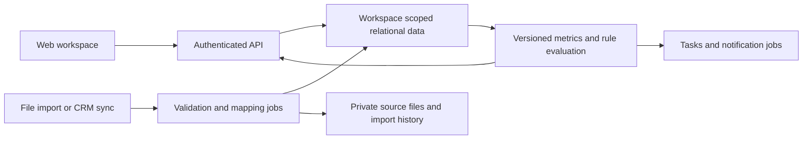

# SalesScope overhaul plan

Prepared October 12, 2026. Initial market: sales teams managing leads and deals.

SalesScope should become a daily sales workspace that helps representatives decide whom to contact, keeps deals moving, and gives managers an explainable view of pipeline and expected bookings. Its existing transaction reports can become the post-sale analytics module. The major investment is a persistent, collaborative lead and deal system with reliable history; a visual redesign alone will not deliver this outcome.

The proposed first release serves small and midsize B2B sales teams. Start with roughly 5–50 sellers as a product hypothesis, then validate that range with pilot companies. Broader industry support should come from configurable processes, fields, and metric definitions built on one shared model.

## Premium visual direction

The new interface should feel calm, deliberate, and polished during a full working day. Use a deep navy navigation rail, warm white work surfaces, muted violet for primary actions and pipeline charts, and restrained amber and green for meaningful status. Keep color attached to a consistent meaning across screens.

| Design element | Implementation direction |
| --- | --- |
| Navigation | Persistent desktop rail with workspace identity, six primary destinations, settings, and account controls; a collapsible mobile menu |
| Type | System sans-serif typography, strong headline hierarchy, readable data labels, and tabular numeric alignment |
| Layout | A wide workspace with a quiet top bar, purposeful page headings, four key metrics, and two-column working sections |
| Surfaces | White cards on a soft neutral canvas, thin borders, restrained shadows, and consistent corner radii |
| Signature component | A dark quarterly target card with a clear progress indicator and useful forecast context |
| Pipeline | Compact opportunity cards with company identity, amount, explained next-step status, owner, and close date; a table alternative for comparison |
| Record details | A focused drawer that preserves the current page context; explicit edit forms and a readable activity timeline |
| Interaction | Consistent primary and secondary buttons, visible keyboard focus, trapped modal focus, clear validation, success feedback, and reduced-motion support |
| Mobile | Stacked working sections, compact metric pairs, horizontal scrolling confined to boards/tables, and accessible navigation |
| Empty states | Explain what data is missing and offer a concrete next action; never invent performance changes to fill a chart |

The visual overhaul should make priorities easier to recognize and records faster to update. Premium presentation is measured by clarity, consistency, accessibility, and responsiveness as well as appearance.

## Current implementation status

The premium interface and core local workflow are now implemented: persistent lead/deal/account/contact records, tasks and activity histories, configurable stages and industry presets, pipeline filters and saved views, forecast snapshots, imports with review and duplicate protection, exports, account sign-in, workspace isolation, and single-use team invitations. The original transaction report remains available separately.

This is the first working implementation of the roadmap. Cloud deployment, CRM and communication integrations, large asynchronous imports, automated operational backups, account recovery, independent multiple pipelines, generalized custom fields, and predictive modeling remain future phases. See `SalesScope-implementation-notes.md` for the implemented scope and verification evidence. The audit below remains tied to the original cloned commit.

## What the app does today

The repository was cloned from [wiltobuild/SalesScope](https://github.com/wiltobuild/SalesScope). This review covers commit `302ee7e16ab89b2ad0e5895ac7b48a5b488590f5`.

| Area | Current behavior | Business value and limit |
| --- | --- | --- |
| Data entry | CSV, XLS, or XLSX upload; first worksheet only; automatic header aliases | Quick access to exports, but users cannot resolve ambiguous mappings or select worksheets |
| Demo data | Embedded Superstore data and a runtime Kaggle download | Useful demonstration; the downloaded dataset remains historical data from 2014–2017 |
| Reporting | Weekly or monthly revenue, cost, profit, units, orders, and comparisons | Useful retrospective analysis; no sales pipeline or targets |
| Exploration | Product, customer, promotion, and optional geographic/category breakdowns; filters, sorting, search, SVG charts | Good reusable interaction patterns; fixed dimensions and limited date controls |
| Customer analysis | Revenue concentration, unprofitable customers, prior-period customers absent this period | Useful clues, but absence for one period does not establish churn |
| Alerts | Revenue declines, low margins, discount losses, below-cost products, concentration, and selected shipping issues | Rules are fixed and tied to transaction data; findings cannot be assigned or tracked |
| Export | A multi-section CSV report | Portable output; no saved shared reports, permission model, or scheduled delivery |
| Application foundation | Static HTML/CSS, one main JavaScript file, SheetJS from a CDN | Easy to run; no application backend, accounts, persistent database, or team collaboration |

The core path is upload or demo → normalize and validate → choose period → calculate report → investigate breakdowns → export. There are no first-class leads, contacts, accounts, opportunities, tasks, rep ownership, stage histories, quotas, or forecast submissions.

Keep the understandable reporting, table-to-chart consistency, drilldowns, and simple onboarding. Rework the fixed schema, global mutable state, long report page, and hardcoded business assumptions. Move Superstore behind a clearly labeled demo experience and add realistic synthetic lead-and-deal demos for each initial template.

## Findings that affect trust

These findings come from source inspection and focused execution of the existing calculation functions. They are reasons to establish a metric and import contract before reusing the reporting engine.

| Finding | Evidence | Planned correction |
| --- | --- | --- |
| The required sales schema excludes ordinary lead and deal exports | `requiredColumns` and `validateRequiredColumns` demand product, quantity, revenue, and cost or profit | Separate import types for leads, deals, activities, and transactions; enable metrics only when supporting fields exist |
| Invalid dates can become valid dates in a different month | `parseDate('2026-02-31')` returns March 3 | Validate calendar components after parsing; require explicit date convention for ambiguous input |
| Common formatted amounts fail parsing | `parseNumber('$1,200.00')` returns null | Preview locale-aware parsing and currency; keep rejected values and reasons |
| Required column headers do not guarantee usable identifiers | `coerceRow` accepts empty order, customer, and product values | Require the appropriate record identity for each import type; keep names separate from stable IDs |
| A missing month changes the comparison baseline | March with only January history compares against January | Show exact baseline dates; distinguish missing coverage from zero activity and support calendar-adjacent comparisons |
| Improving losses produce misleading percentage signs | Profit moving from −100 to −50 returns −50% | Prefer absolute change and explicit “loss narrowed” wording when crossing or using negative baselines |
| At-risk data is truncated before presentation and export | Fifteen absent prior-period customers produce ten records | Calculate the full result, then paginate the interface independently |
| Currency display assumes dollars | `formatMoney` and `formatCompactMoney` prepend `$` | Store currency codes; select a reporting currency; never silently sum unlike currencies |
| Export escaping does not neutralize spreadsheet formulas | `csvEscape('=1+1')` returns the formula unchanged | Protect text cells when exporting to spreadsheet formats; preserve numeric types |
| Keyboard interaction is incomplete | Focusable breakdown rows use delegated click handling without a corresponding keyboard handler | Use semantic controls and verify keyboard activation and focus retention |
| Parser delivery is not pinned | `index.html` references `xlsx-latest` | Pin and bundle dependencies, use a lockfile, and review updates deliberately |

The embedded-data check reproduced 9,994 rows, 5,009 orders, $2,297,200.86 revenue, and $2,010,803.84 cost. It also generated the current report markup and CSV. This was a calculation-level check with a minimal DOM stub, not a browser rendering, upload-parser, live Kaggle, accessibility, or performance certification. Raw results are in `salesscope-audit-results.json` beside this plan.

## Product position

The promise should be: **Know which deals need attention, understand why, and leave every review with clear next steps.**

Pipeline boards and general dashboards are established expectations: Pipedrive documents customizable pipelines, activity visibility, and reporting, while HubSpot offers reporting templates and connected CRM reporting. Zoho Analytics documents connectors across business systems. These sources establish the competitive baseline, not proof that customers will buy SalesScope. [Pipedrive pipeline management](https://www.pipedrive.com/en/features/pipeline-management), [HubSpot reporting](https://www.hubspot.com/products/reporting-dashboards), [Zoho connectors](https://www.zoho.com/analytics/help/import-data/business-app.html).

SalesScope's differentiation hypothesis is a particularly clear daily queue and weekly deal review: explainable risks, visible changes since the last review, and direct assignment of the next action. Validate whether this saves enough time and prevents enough missed follow-ups to justify switching or adding another tool.

Choose a clear source of truth. The first release should support teams working in spreadsheets that can adopt SalesScope as their deal system. Add a read-only CRM connection for a subsequent pilot; imported CRM fields stay owned by that CRM, while SalesScope owns review notes and its own tasks. Treat two-way synchronization as a later product with explicit conflict rules. Supporting both unrestricted local editing and CRM ownership at launch would create avoidable complexity.

## The new user experience

Replace the upload-and-report page with a workspace containing Today, Leads, Pipeline, Accounts and Contacts, Forecast, Reports, and Settings. Data imports and source health belong in Settings with visible status indicators throughout the workspace.

| Screen | Primary question | Essential behavior |
| --- | --- | --- |
| Today | What should I act on next? | Assigned leads, overdue tasks, deals without a next step, approaching close dates, and explained priorities; complete, reschedule, or assign an action directly |
| Leads | Which inquiries deserve a conversation? | Capture or import, deduplicate, assign, qualify, disqualify with a reason, and convert to an account/contact/deal without losing history |
| Pipeline | What is moving and what is stuck? | Board and table views, saved filters, configurable stages, aging, amount, owner, next action, close date, and changes since last review |
| Deal detail | What will move this opportunity forward? | Account and buying contacts, activity timeline, qualification checklist, next action, stage history, risks, and relevant files or links |
| Accounts and Contacts | Who are we selling to? | Stable identities, multiple contacts and roles, related opportunities, communication notes, and ownership |
| Forecast | What might close in this period? | Booked wins, open pipeline, forecast categories, target gap, close-date slips, manager adjustments, and historical snapshots |
| Reports | Where does the process need improvement? | Cohort conversion, win/loss reasons, sales cycle, stage aging, source results, and later transaction profitability |

Onboarding should ask for business model, team, timezone, reporting currency, and pipeline template. Then import records with a mapping preview or create a first deal manually. Before leaving onboarding, assign an owner and a next action to that deal. A spreadsheet user should reach this first useful state within 15 minutes; this is a proposed pilot target.

Use a wide desktop workspace, a compact navigation rail, and a detail drawer so investigation preserves the current view. Keep the green brand accent and accessible chart palette. On smaller screens, prioritize the Today queue, contact information, task completion, and quick activity logging. Support empty, loading, partial-data, permission-denied, failed-sync, and no-results states as designed product states.

### Example workflow

A services company imports 200 leads. SalesScope previews duplicates, maps owners, and identifies leads missing contact details. A rep qualifies a lead and creates a deal with an estimated contract value, buying contact, and scheduled discovery call. After discovery, the rep changes stage and records a proposal task. If the proposal task becomes overdue, the deal appears in Today with that specific reason.

At the weekly review, the manager sees that the deal's close date moved, the proposal is overdue, and no customer meeting is scheduled. The manager assigns a recovery action and records a forecast adjustment. When the deal closes, the result remains a booking; later linked invoices or payments show financial outcomes separately.

## A shared foundation for different companies

Business templates should configure the same underlying objects and workflows. Permit multiple pipelines within a workspace, with shared reporting only where metric definitions align.

| Company type | Useful pipeline template | Fields and insight priorities |
| --- | --- | --- |
| B2B software | Qualification → Discovery → Evaluation → Procurement → Won/Lost | Contract term, recurring value, champion, evaluation dates; expansion and renewal opportunities later |
| Agencies and consultancies | Inquiry → Discovery → Scope → Proposal → Negotiation → Won/Lost | Service line, estimated project value, proposed start date, expected delivery cost; separate estimates from actual margin |
| Manufacturers and distributors | Inquiry → Technical qualification → Quote → Negotiation → Purchase order → Won/Lost | Product family, quote version, territory, lead time; order and margin analysis after sale |
| Commercial services and contractors | Inquiry → Site assessment → Estimate → Follow-up → Won/Lost | Location, assessment date, estimate amount, service category, follow-up deadline |

Make stage names, qualification fields, loss reasons, lead sources, owner rules, stale-deal thresholds, fiscal periods, and saved views configurable. Provide useful defaults and progressive disclosure so setup does not become a consulting project.

Pilot agencies/services and one product-selling B2B segment first. Software and more specialized workflows follow once the shared model works across the first two. Broad usefulness does not require shipping every template and integration simultaneously.

## Features in delivery order

| Priority | Capability | Acceptance condition |
| --- | --- | --- |
| P0 | Workspaces, accounts, roles, persistent storage | Data survives reload; tenant access is enforced on the server; a rep cannot read or modify another team's restricted records |
| P0 | Lead, account, contact, and deal model | A lead converts once without losing source history; contacts can relate to several deals without duplicating people |
| P0 | Mapping and import review | Users choose worksheet, map fields, resolve ambiguity, inspect errors, and confirm counts; reimport does not silently duplicate records |
| P0 | Configurable pipeline and history | Stage changes, owners, values, and dates persist with actor and timestamp; simultaneous edits produce an explicit conflict |
| P0 | Tasks and Today queue | Every active deal can have a next step; overdue and missing actions surface with direct links and clear reasons |
| P1 | Manager review and saved views | Managers inspect changes since a previous snapshot, assign actions, and revisit review decisions |
| P1 | Baseline forecasting and targets | Forecast totals reconcile to included deals and definitions; adjustments retain an audit trail |
| P1 | Rules and notifications | Configurable inactivity and close-date rules; repeated unchanged alerts are grouped or suppressed; users control delivery |
| P1 | First read-only CRM integration | Choose the provider from pilot demand; retries and replay are safe; record ownership and last successful sync are visible |
| P2 | Transaction analytics | Link financial records to accounts and deals without counting bookings and invoiced revenue twice |
| P2 | Assisted summaries and drafting | Summaries link to authorized records; numerical claims come from the metric service; drafts require a user action before sending |
| P2 | Expansion features | Additional connectors, renewal workflows, forecasting models, and controlled two-way sync only after the core usage is proven |

Do not put automated outreach, a general workflow builder, billing, inventory, enterprise territory planning, or predictive lead scoring in the first release. Those features require additional domain models and operating costs. Manual lead creation, file import, tasks, and activity logging are sufficient to validate the core loop.

## Metric definitions and useful intelligence

Write a metric dictionary before implementing dashboards. Every metric should declare its population, time basis, currency, exclusions, and data requirements, with a link to contributing records.

| Metric | Proposed definition and constraint |
| --- | --- |
| Open pipeline | Sum of open opportunity amounts in the selected scope and reporting currency; state whether filtered by expected close date |
| Booked wins | Sum of won contract values using actual won date; label separately from invoiced revenue, recognized revenue, and cash collected |
| Weighted pipeline | Sum of open amount × configured stage probability; identify it as a scenario estimate, not a calibrated prediction |
| Forecast | Won amount in the period plus selected mutually exclusive open forecast categories; show any manager adjustment separately |
| Win rate | Won deals divided by won plus lost deals closed in the period; state exclusions and handle reopened deals through history |
| Lead conversion | Converted qualified opportunities from a defined lead creation cohort divided by that cohort's eligible leads; expose the observation window |
| Stage conversion | Historical opportunities progressing through defined stages within a stated cohort; current stage counts alone are not conversion rates |
| Sales cycle | Median elapsed time from the chosen starting event to won date; label the start event and show sample size |
| Pipeline coverage | Relevant open pipeline divided by remaining bookings target; return not applicable when the denominator is zero or negative |
| Deal inactivity | Time since a qualifying customer interaction; internal notes and automated updates must not reset this clock by default |

Start with deterministic risk reasons: overdue next action, no owner, no buying contact, close date passed, repeated close-date slips, or excessive time in stage. Rules need business-specific defaults and editable thresholds. Display missing data separately from evidence of a stalled sale. Do not present a numerical win probability as machine-learned without sufficient historical data and calibration checks.

Later forecasts should use point-in-time snapshots and rolling historical backtests, compare with a simple baseline, and show error by forecast horizon and segment. Do not train on fields that were only known after the predicted outcome. For sparse histories, show a scenario range and explain the limited basis.

## Technical architecture

Use a modular web application with a typed frontend, authenticated API, managed relational database, private file storage, and background workers. A TypeScript frontend and API are a reasonable default for maintainability; pick exact framework and hosting after confirming the team's skills and operating budget. A relational database fits the linked records and historical reporting. A separate analytical warehouse is unnecessary for the pilot unless measured volumes justify it.

Core records: Workspace, Membership, Team, Account, Contact, Lead, Deal, DealContact, Pipeline, Stage, Activity, Task, Target, ForecastSnapshot, StageEvent, AuditEvent, ImportBatch, ImportRowError, SourceRecord, CustomFieldDefinition, and CustomFieldValue. Add Transaction and TransactionLine when bringing forward post-sale analytics. Store tenant identity on all relevant records and enforce isolation in API queries, database policies or equivalent database controls, file access, workers, caches, and exports.

Record actual business event time separately from the time SalesScope received it. Keep source system and external ID, import batch, and mapping version for reconciliation. Historical stage changes and forecast snapshots must survive configuration changes; a current CRM snapshot cannot reconstruct earlier history accurately.

Use decimal monetary storage or explicit minor units with currency precision rules. Store original currency and any conversion rate/date used for a reporting amount. Start with one reporting currency per workspace and block mixed-currency aggregation until conversion is configured.

Imports should move through upload → profile → map → validate → preview → commit → reconcile. Preserve source files according to the workspace's retention policy; allow users to download rejected rows with reasons. Require an explicit identity strategy when stable external IDs are absent. Distinguish repeated imports from legitimate repeated line items. Implement import undo through batch provenance and conflict-aware reversal, not broad deletion of subsequently edited records.

Workers need bounded retries, checkpoints, idempotency keys, error visibility, and per-tenant limits. Begin connectors with backfill plus incremental sync and reconciliation. Deleted or merged upstream records need explicit handling. Never silently overwrite a locally owned task or review note with a CRM snapshot.

Provide owner/admin, manager, representative, and read-only roles, with own/team/workspace scopes. Verify authorization independently of interface hiding. Keep connector credentials server-side, restrict exports, audit sensitive changes, and exercise backup restoration before shared pilots. Add SSO and more detailed field permissions only when customer requirements justify them.

Extract the current calculations into isolated functions with explicit inputs, after fixing the documented semantics. Replace global report state with explicit view and data boundaries. Preserve the existing app as a reference and maintain known financial totals for regression checks. The first implementation uses a dependency-free JavaScript interface and Node/SQLite backend; a typed framework and hosted relational database remain options when production requirements justify the migration.

## Rollout and implementation roadmap

Planning estimate: 12–16 elapsed weeks for a focused pilot with two experienced engineers, part-time product/design support, and ongoing QA. This assumes timely pilot access, one limited connector, and no enterprise procurement or compliance program. A solo implementation will take longer; these are sequencing estimates rather than a delivery commitment.

| Phase | Indicative timing | Deliverables and exit gate |
| --- | --- | --- |
| Discovery and contracts | Weeks 1–2 | Interview 6–8 reps/managers across two segments; collect anonymized lead/deal exports; agree on metric definitions and source ownership; test Today and deal-review prototypes |
| Foundation and import | Weeks 3–5 | Workspaces, roles, core records, import staging, mappings, audit history, dependency/build setup; reconcile representative files and pass tenant-isolation checks |
| Daily sales workflow | Weeks 6–8 | Leads, conversion, contacts/accounts, pipeline, deal detail, tasks, Today, two templates; a rep completes the full lead-to-won/lost flow and a manager assigns a review action |
| Management and pilot | Weeks 9–12 | Forecast snapshots, targets, explained rules, saved views, scoped exports, operational monitoring; 3–5 companies complete weekly reviews using real data |
| Integration and hardening | Weeks 13–16 | One read-only CRM connector if validated by demand, notification controls, import recovery, performance tuning, accessibility and restore checks; resolve pilot blockers |

Phases depend on their exit gates. Delay the connector if import quality or daily usage is weak. Move a read-only connector earlier only if discovery shows the target teams already have CRMs and will not maintain data in SalesScope; in that case narrow native editing rather than building both ownership models simultaneously.

Release into a separate development and staging environment, then invite limited pilot workspaces. Keep the existing static application available during validation. Do not migrate users or assume stored customer data exists: the current application has no server-side user database. The migration path is file reimport with explicit mapping into either transaction records or the new lead/deal records.

### First implementation backlog

1. Obtain two realistic deal exports and define lead, deal, activity, and transaction import contracts.
2. Build and validate a clickable Today → deal detail → assign next action → manager review flow.
3. Establish the typed application, database migrations, CI, and separate environment configuration.
4. Implement workspace membership, record scopes, and authorization checks before shared data entry.
5. Add accounts, contacts, leads, pipelines, deals, and immutable change history.
6. Build import staging with preview, saved mappings, duplicate detection, error downloads, and reconciliation totals.
7. Implement board/table navigation, task actions, lead conversion, and optimistic concurrency handling.
8. Add the agreed metric service and baseline manager review with point-in-time snapshots.

## Validation and success criteria

Test the risks that could change business decisions: tenant isolation, identity resolution, duplicate imports, date parsing, money precision, missing history, stage changes, concurrent updates, forecast arithmetic, and authorization for background jobs and exports. Use browser tests for import, lead conversion, task completion, deal updates, and manager review. Verify keyboard navigation and screen-reader labels on those flows.

Set performance targets against declared test hardware and datasets. Initial proposals: ordinary filtered views respond within two seconds at the 95th percentile for a workspace with 50,000 deals; a 100,000-row import runs asynchronously with progress and recoverable failure. These targets require measurement and are not current app capabilities.

| Proposed pilot measure | Target or decision rule |
| --- | --- |
| First useful session | At least 80% of pilot admins import or create an owned deal with a next action within 15 minutes |
| Ongoing adoption | At least 60% of invited pilot reps use the core workflow weekly for four consecutive weeks |
| Pipeline hygiene | Reduce open deals without a next action by 30% relative to each pilot's starting baseline |
| Manager efficiency | Reduce weekly review preparation time by 30%, measured before and after |
| Import trust | Every committed batch reconciles accepted, rejected, and duplicate records; no unexplained amount differences |
| Commercial validation | Obtain explicit willingness to continue using and paying from at least three pilot companies before expanding integrations |

Treat these as hypotheses to validate, not promised business outcomes. Track follow-up completion and review quality before claiming improved win rates; sales-cycle length and small samples can make early revenue changes misleading.

Avoid committing to a price before pilots. Test workspace-plus-active-seat packaging and clear usage limits; understand database, storage, worker, connector, support, and optional AI costs. Core manual workflows and deterministic analysis should remain useful without paying for model calls.

The first build should prove one complete loop: import or create a lead, qualify it, manage the deal, complete follow-ups, explain its risks during review, and record the outcome. That loop is the foundation for expanding SalesScope across companies.

## Repository evidence

- [Page structure and dependency loading](https://github.com/wiltobuild/SalesScope/blob/302ee7e16ab89b2ad0e5895ac7b48a5b488590f5/index.html)
- [Schema and required fields](https://github.com/wiltobuild/SalesScope/blob/302ee7e16ab89b2ad0e5895ac7b48a5b488590f5/script.js#L19-L85)
- [Parsing and ingestion](https://github.com/wiltobuild/SalesScope/blob/302ee7e16ab89b2ad0e5895ac7b48a5b488590f5/script.js#L199-L441)
- [Comparisons and alert rules](https://github.com/wiltobuild/SalesScope/blob/302ee7e16ab89b2ad0e5895ac7b48a5b488590f5/script.js#L949-L1125)
- [Customer analysis and currency formatting](https://github.com/wiltobuild/SalesScope/blob/302ee7e16ab89b2ad0e5895ac7b48a5b488590f5/script.js#L1176-L1222)
- [CSV export](https://github.com/wiltobuild/SalesScope/blob/302ee7e16ab89b2ad0e5895ac7b48a5b488590f5/script.js#L1625-L1738)
- [Documented scope](https://github.com/wiltobuild/SalesScope/blob/302ee7e16ab89b2ad0e5895ac7b48a5b488590f5/README.md)
